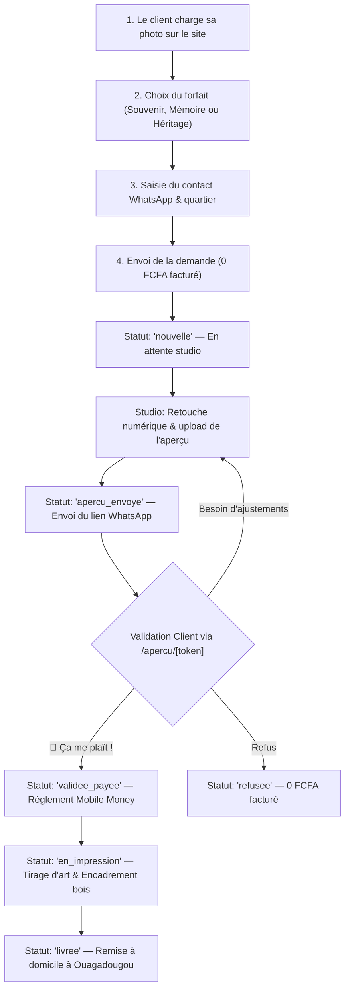

# Mémoire Vive — Architecture Complète & Recueil Intégral des Textes

> Ce document regroupe l'**architecture technique complète** du site web **Mémoire Vive** ainsi que **l'intégralité des textes et contenus rédactionnels** présents sur toutes les pages publiques, formulaires, modales, pages légales et espace d'administration.

---

## TABLE DES MATIÈRES

1. [Architecture Globale & Choix Techniques](#1-architecture-globale--choix-techniques)
2. [Structure des Fichiers & Arborescence](#2-structure-des-fichiers--arborescence)
3. [Base de Données, Sécurité & Stockage (Supabase)](#3-base-de-données-sécurité--stockage-supabase)
4. [Parcours Utilisateur & Cycle de Vie des Commandes](#4-parcours-utilisateur--cycle-de-vie-des-commandes)
5. [Textes Intégraux — Page d'Accueil (`/`)](#5-textes-intégraux--page-daccueil-)
   - [5.1 Bandeau de Réassurance Supérieur (`TrustBar`)](#51-bandeau-de-réassurance-supérieur-trustbar)
   - [5.2 En-tête & Navigation (`Header`)](#52-en-tête--navigation-header)
   - [5.3 Section Hero Principale (`Hero`)](#53-section-hero-principale-hero)
   - [5.4 Curseur Avant/Après & Carrousel 6 Catégories (`BeforeAfterSlider`)](#54-curseur-avantaprès--carrousel-6-catégories-beforeafterslider)
   - [5.5 Section « Comment ça marche ? » (`HowItWorks`)](#55-section--comment-ça-marche--howitworks)
   - [5.6 Section « 3 Forfaits Simples » (`PricingSection`)](#56-section--3-forfaits-simples--pricingsection)
   - [5.7 Section Garantie Totale « Zéro Risque » (`GuaranteeSection`)](#57-section-garantie-totale--zéro-risque--guaranteesection)
   - [5.8 Section Témoignages & Preuve Sociale (`Testimonials`)](#58-section-témoignages--preuve-sociale-testimonials)
   - [5.9 Section Foire Aux Questions (`FAQSection`)](#59-section-foire-aux-questions-faqsection)
   - [5.10 Appel à l'Action Final (`FinalCTA`)](#510-appel-à-laction-final-finalcta)
   - [5.11 Pied de Page (`Footer`)](#511-pied-de-page-footer)
   - [5.12 Barre Flottante Mobile (`StickyMobileBar`)](#512-barre-flottante-mobile-stickymobilebar)
6. [Textes Intégraux — Formulaire de Commande en 4 Étapes (`OrderModal`)](#6-textes-intégraux--formulaire-de-commande-en-4-étapes-ordermodal)
   - [6.1 En-tête de la Modale](#61-en-tête-de-la-modale)
   - [6.2 Étape 1 : Téléchargement de la Photo (`StepUpload`)](#62-étape-1--téléchargement-de-la-photo-stepupload)
   - [6.3 Étape 2 : Choix du Forfait (`StepPackage`)](#63-étape-2--choix-du-forfait-steppackage)
   - [6.4 Étape 3 : Coordonnées & Livraison (`StepContact`)](#64-étape-3--coordonnées--livraison-stepcontact)
   - [6.5 Étape 4 : Récapitulatif, Envoi & Confirmation (`StepSuccess`)](#65-étape-4--récapitulatif-envoi--confirmation-stepsuccess)
7. [Textes Intégraux — Page Publique de l'Aperçu Client (`/apercu/[token]`)](#7-textes-intégraux--page-publique-de-laperçu-client-apercutoken)
8. [Textes Intégraux — Pages Légales](#8-textes-intégraux--pages-légales)
   - [8.1 Conditions Générales (`/conditions-generales`)](#81-conditions-générales-conditions-generales)
   - [8.2 Politique de Confidentialité (`/politique-de-confidentialite`)](#82-politique-de-confidentialité-politique-de-confidentialite)
9. [Textes & Interface — Espace Administration Studio (`/wendclass`)](#9-textes--interface--espace-administration-studio-wendclass)
   - [9.1 Page de Connexion Admin (`/wendclass/login`)](#91-page-de-connexion-admin-wendclasslogin)
   - [9.2 Tableau de Bord Général (`/wendclass`)](#92-tableau-de-bord-général-wendclass)
   - [9.3 Gestion des Commandes (`/wendclass/commandes`)](#93-gestion-des-commandes-wendclasscommandes)
   - [9.4 Fiche Détail d'une Commande (`/wendclass/commandes/[id]`)](#94-fiche-détail-dune-commande-wendclasscommandesid)
   - [9.5 Répertoire Clients (`/wendclass/clients`)](#95-répertoire-clients-wendclassclients)

---

## 1. ARCHITECTURE GLOBALE & CHOIX TECHNIQUES

### 1.1 Positionnement & Marché
- **Nom du service** : Mémoire Vive
- **Activité** : Restauration numérique de photos anciennes/abîmées assistée par IA & encadrement artisanal en bois noble
- **Marché cible** : Burkina Faso (Ouagadougou en priorité, quartiers urbains)
- **Promesse commerciale clé** : Aperçu gratuit avant tout paiement. Zéro franc d'avance. Le client ne paie en Mobile Money (Orange Money / Moov Money) que s'il est 100% satisfait du résultat.

### 1.2 Stack Technologique
- **Framework Web** : [Next.js 14](https://nextjs.org/) (App Router, Server Components + Client Components optimisés)
- **Langage** : TypeScript strict
- **Design & Styles** : Tailwind CSS avec charte sur-mesure « Éclat Chaleureux »
- **Typographies Google Fonts** :
  - `Fraunces` : Titres de prestige à empattements, chaleureux et mémorables
  - `Plus Jakarta Sans` : Texte courant moderne, très lisible sur smartphone
- **Icônes** : [Lucide React](https://lucide.dev/)
- **Base de données & Stockage** : [Supabase](https://supabase.com/) (PostgreSQL géré, Row Level Security, Buckets Storage S3-compatibles)
- **Hébergement & Déploiement** : [Vercel](https://vercel.com/) avec intégration Git continue sur branche `main`
- **Canal de Relation Client** : WhatsApp via l'API universelle de liens profonds `wa.me`

### 1.3 Charte Graphique & Palette de Couleurs
| Rôle | Nom / Teinte | Code Hex | Utilisation |
|---|---|---|---|
| **Primaire** | Violet Vif de Marque | `#7C3AED` | Boutons d'action principaux (CTA), liens actifs, logo |
| **Accent Chaud** | Rose / Magenta Éclatant | `#EC4899` | Badges « Le plus choisi », surbrillances, contrastes |
| **Prestige** | Or / Ambre Chaleureux | `#F59E0B` | Étoiles d'avis, étiquettes premium, icônes d'éclat |
| **Fond Général** | Crème Très Clair | `#FFFBF7` | Fond reposant et doux, valorisant les photographies |
| **Texte Principal** | Anthracite Profond | `#1E1B2E` | Lisibilité maximale sans la dureté d'un noir pur |
| **Texte Secondaire**| Gris Ambré Adouci | `#5B556D` | Sous-titres, descriptions, métadonnées |
| **Thème Admin** | Dark Studio Pur | `#150F1B` & `#241B2E` | Ambiance laboratoire photo nocturne pour l'admin |

---

## 2. STRUCTURE DES FICHIERS & ARBORESCENCE

```text
00_Site_Web/
├── .env.local                          # Variables secrètes locales (non commitées)
├── .env.example                        # Modèle des variables pour le déploiement
├── .gitignore                          # Fichiers exclus de Git
├── next.config.mjs                     # Configuration Next.js (domaines d'images distants)
├── package.json                        # Dépendances npm et scripts
├── postcss.config.js                   # Configuration PostCSS / Tailwind
├── tailwind.config.ts                  # Définition des couleurs de marque et polices
├── tsconfig.json                       # Configuration TypeScript
├── gemini.md                           # Document de cadrage initial
│
├── supabase/                           # Scripts SQL de structure et sécurité
│   ├── setup-complete.sql              # Schéma complet (tables, vues, triggers, storage)
│   ├── migration-apercu-public.sql     # Migration de la vue publique et token UUID
│   └── schema.sql                      # Ancien schéma de référence
│
└── src/
    ├── middleware.ts                   # Protection stricte des routes /wendclass/*
    │
    ├── app/                            # Routes Next.js App Router
    │   ├── layout.tsx                  # Layout racine (polices Fraunces/Jakarta, métadonnées)
    │   ├── globals.css                 # Animations CSS personnalisées (curtain reveal, glow)
    │   ├── page.tsx                    # Page d'accueil publique complète
    │   │
    │   ├── apercu/
    │   │   └── [token]/
    │   │       └── page.tsx            # Page d'aperçu client sécurisée + OpenGraph WhatsApp
    │   │
    │   ├── conditions-generales/
    │   │   └── page.tsx            # Page légale des conditions générales
    │   ├── politique-de-confidentialite/
    │   │   └── page.tsx            # Page légale de confidentialité
    │   │
    │   ├── api/                        # Routes d'API serveur Next.js
    │   │   ├── commandes/
    │   │   │   └── route.ts            # POST public : enregistrement d'une commande
    │   │   └── wendclass/              # Routes privées réservées à l'administration
    │   │       ├── auth/
    │   │       │   ├── login/route.ts  # Authentification admin + rate limiting
    │   │       │   └── logout/route.ts # Déconnexion admin
    │   │       ├── stats/route.ts      # Chiffres clés et données financières
    │   │       └── commandes/
    │   │           ├── route.ts        # Liste filtrée des commandes
    │   │           └── [id]/
    │   │               ├── route.ts    # Lecture et mise à jour du statut
    │   │               └── preview/route.ts # Upload de l'aperçu retouché
    │   │
    │   └── wendclass/                  # Espace administration Studio
    │       ├── layout.tsx              # Layout du panneau d'administration
    │       ├── AdminLayoutClient.tsx   # Coque avec barre latérale et navigation
    │       ├── page.tsx                # Tableau de bord principal (stats, KPIs, graphiques)
    │       ├── login/page.tsx          # Écran de connexion sécurisé
    │       ├── commandes/
    │       │   ├── page.tsx            # Liste de toutes les commandes avec filtres
    │       │   └── [id]/page.tsx       # Fiche de traitement de commande détaillée
    │       └── clients/page.tsx        # Répertoire des clients et historique des commandes
    │
    ├── components/                     # Composants UI modulaires
    │   ├── TrustBar.tsx                # Bandeau d'assurance supérieur
    │   ├── Header.tsx                  # En-tête principal et menu mobile
    │   ├── Hero.tsx                    # Section haute d'impact avec double affichage
    │   ├── BeforeAfterSlider.tsx       # Curseur interactif 6 catégories avec Ken Burns
    │   ├── HowItWorks.tsx              # Explication du processus en 3 étapes
    │   ├── PricingSection.tsx          # Les 3 forfaits avec mise en avant du Best-seller
    │   ├── GuaranteeSection.tsx        # Bloc d'inversion du risque « Zéro Risque »
    │   ├── Testimonials.tsx            # Preuve sociale locale à Ouagadougou
    │   ├── FAQSection.tsx              # Questions fréquentes en accordéon
    │   ├── FinalCTA.tsx                # Appel à l'action final chaleureux
    │   ├── Footer.tsx                  # Pied de page avec liens et contacts
    │   ├── StickyMobileBar.tsx         # Barre fixe d'action pour le pouce sur smartphone
    │   │
    │   ├── OrderModal/                 # Modale interactive de commande en 4 étapes
    │   │   ├── OrderModal.tsx          # Gestionnaire d'état, progression et persistance
    │   │   ├── StepUpload.tsx          # Étape 1 : Photo et note optionnelle
    │   │   ├── StepPackage.tsx         # Étape 2 : Sélection du forfait
    │   │   ├── StepContact.tsx         # Étape 3 : Coordonnées et quartier à Ouagadougou
    │   │   └── StepSuccess.tsx         # Étape 4 : Récapitulatif, soumission et validation
    │   │
    │   └── admin/                      # Composants spécifiques à l'administration
    │       ├── AdminContext.tsx        # Contexte React global admin
    │       ├── AdminHeader.tsx         # Barre d'en-tête admin
    │       ├── AdminSidebar.tsx        # Menu de navigation latéral
    │       ├── OrdersChart.tsx         # Graphique d'évolution des commandes
    │       ├── StatCard.tsx            # Carte de métrique financière
    │       └── StatusBadge.tsx         # Badge visuel de statut de commande
    │
    └── lib/                            # Logique métier et utilitaires
        ├── admin-auth.ts               # Sécurité cookies HMAC SHA-256 sans Buffer
        ├── admin-db.ts                 # Types TypeScript des commandes et données mock
        ├── supabase.ts                 # Initialisation des clients Supabase (anon & admin)
        ├── supabase-db.ts              # Fonctions de requêtes PostgreSQL et Storage
        └── utils.ts                    # Formateur de devises FCFA et normaliseur WhatsApp
```

---

## 3. BASE DE DONNÉES, SÉCURITÉ & STOCKAGE (SUPABASE)

### 3.1 Table `public.commandes`
| Colonne | Type | Description / Rôle |
|---|---|---|
| `id` | `UUID PRIMARY KEY` | Identifiant interne unique de la commande (`gen_random_uuid()`) |
| `lien_public` | `UUID UNIQUE` | Jeton public aléatoire et non devinable pour l'URL client `/apercu/[token]` |
| `created_at` | `TIMESTAMPTZ` | Horodatage automatique de réception de la commande |
| `updated_at` | `TIMESTAMPTZ` | Horodatage de dernière modification (mis à jour par trigger) |
| `client_nom` | `TEXT` | Nom et prénom du client |
| `client_telephone` | `TEXT` | Numéro WhatsApp du client (format brut normalisé) |
| `client_quartier` | `TEXT` | Quartier de livraison à Ouagadougou |
| `client_adresse_details`| `TEXT` | Précisions d'adresse (repère, von, pharmacie, etc.) |
| `forfait_id` | `TEXT` | Forfait sélectionné : `'souvenir'`, `'memoire'`, ou `'heritage'` |
| `forfait_nom` | `TEXT` | Nom lisible du forfait |
| `forfait_prix` | `INTEGER` | Prix en Francs CFA (10000, 20000, ou 35000) |
| `forfait_format` | `TEXT` | Dimensions physiques du cadre |
| `occasion_note` | `TEXT` | Précisions ou souhaits de retouche rédigés par le client |
| `photo_originale_url` | `TEXT` | Chemin ou URL de la photo brute envoyée par le client |
| `photo_apercu_url` | `TEXT` | URL publique de l'aperçu retouché par le studio |
| `statut` | `TEXT` | Statut de la commande (voir section 4) |
| `mode_paiement` | `TEXT` | Moyen de paiement : `'orange_money'` ou `'moov_money'` |
| `reference_paiement` | `TEXT` | Identifiant de transaction Mobile Money |

### 3.2 Vue Sécurisée Restreinte `public.apercu_public_view`
Afin de garantir une **confidentialité absolue**, le public (rôle `anon`) n'a **JAMAIS** accès en lecture (`SELECT`) à la table `commandes` complète (qui renferme les numéros de téléphone et adresses). La page client interroge exclusivement cette vue :
```sql
CREATE OR REPLACE VIEW public.apercu_public_view AS
SELECT
    lien_public,
    client_nom,
    forfait_nom,
    forfait_id,
    forfait_format,
    photo_apercu_url,
    statut,
    created_at
FROM public.commandes;
```

### 3.3 Stockage de Fichiers (Supabase Storage)
- **Bucket `photos-commandes` (100% PRIVÉ)** : Reçoit les photos originales des clients (limite 10 Mo, formats images). Upload autorisé pour `anon`, lecture **strictement réservée à l'administrateur** via URL signée temporaire (1 heure).
- **Bucket `apercus-commandes` (LECTURE PUBLIQUE)** : Reçoit les versions retouchées en haute définition téléversées par le studio. La lecture publique est indispensable pour l'affichage fluide de l'image et pour que les serveurs WhatsApp puissent générer la vignette Open Graph dans la conversation.

---

## 4. PARCOURS UTILISATEUR & CYCLE DE VIE DES COMMANDES



---

## 5. TEXTES INTÉGRAUX — PAGE D'ACCUEIL (`/`)

### 5.1 Bandeau de Réassurance Supérieur (`TrustBar`)
- **Élément 1** : `Aperçu gratuit avant paiement` (avec icône étincelle or)
- **Élément 2** : `Livraison soignée à Ouagadougou` (avec icône repère magenta)
- **Élément 3** : `0 FCFA d'avance · Zéro risque` (avec icône bouclier or)

---

### 5.2 En-tête & Navigation (`Header`)
- **Logo de la marque** : `Mémoire Vive`
- **Sous-titre du logo** : `Restauration & Encadrement`
- **Bouton d'aide WhatsApp (Desktop)** : `Aide WhatsApp`
  - *Lien direct :* `https://wa.me/22675864399?text=Bonjour%20Mémoire%20Vive%2C%20j%27aimerais%20des%20informations%20sur%20la%20restauration%20d%27une%20photo`
- **Bouton d'action principal (Desktop)** : `Aperçu gratuit` | Badge : `0 FCFA`
- **Menu mobile déroulant** :
  - Lien 1 : `Nos 3 Forfaits`
  - Lien 2 : `Comment ça marche`
  - Lien 3 : `Questions fréquentes`
  - Bouton Mobile CTA : `Envoyer ma photo (0 FCFA d'avance)`

---

### 5.3 Section Hero Principale (`Hero`)
- **Badge d'accroche** : `Le cadeau souvenir idéal à Ouagadougou` (version mobile) / `Le cadeau souvenir personnalisé à Ouagadougou` (version desktop)
- **Titre principal H1** :
  > *« Offrez une seconde vie à vos **photos de famille** »*
- **Sous-titre** :
  > *« Envoyez votre photo, recevez un aperçu gratuit sous 24h, payez seulement si ça vous plaît. »*
- **Arguments clés (Desktop)** :
  - `Aperçu gratuit avant paiement`
  - `Cadre en bois véritable`
  - `Livraison Ouagadougou`
  - `Orange & Moov Money`
- **Bouton d'action principal** :
  - Intitulé : `Envoyer ma photo`
- **Mention de réassurance sous le bouton** :
  - Version Mobile : `Aperçu 100% gratuit · Zéro franc d'avance`
  - Version Desktop : `0 FCFA maintenant · Paiement après validation de l'aperçu`

---

### 5.4 Curseur Avant/Après & Carrousel 6 Catégories (`BeforeAfterSlider`)
Le carrousel d'illustrations présente 6 cas concrets de réalisations :

#### Catégorie 1 : Restauration & mémoire familiale
- **Onglet court** : `Restauration`
- **Titre complet** : `Restauration & mémoire familiale`
- **Légende descriptive** : `Exemple : Photo familiale ancienne restaurée & colorisée en cadre bois noble`
- **Étiquette résultat** : `Résultat`

#### Catégorie 2 : Portraits de réussite
- **Onglet court** : `Réussite`
- **Titre complet** : `Portraits de réussite`
- **Légende descriptive** : `Exemple : Diplôme & soutenance sublimés pour honorer vos accomplissements`
- **Étiquette résultat** : `Studio`

#### Catégorie 3 : Portraits en tenue traditionnelle
- **Onglet court** : `Traditionnelle`
- **Titre complet** : `Portraits en tenue traditionnelle`
- **Légende descriptive** : `Exemple : Faso Dan Fani et parures d'apparat aux couleurs chatoyantes ravivées`
- **Étiquette résultat** : `Colorisé`

#### Catégorie 4 : Célébrations & cérémonies
- **Onglet court** : `Célébrations`
- **Titre complet** : `Célébrations & cérémonies`
- **Légende descriptive** : `Exemple : Cérémonie de mariage préservée et immortalisée avec émotion`
- **Étiquette résultat** : `Édition`

#### Catégorie 5 : Anniversaires
- **Onglet court** : `Anniversaires`
- **Titre complet** : `Anniversaires`
- **Légende descriptive** : `Exemple : Cadre personnalisé avec message d'anniversaire festif aux accents violet, rose et or`
- **Étiquette résultat** : `Cadeau`
- **Encart spécial dédicace** :
  - Surtitre : `Message personnalisé inclus`
  - Texte de dédicace : `« Joyeux Anniversaire Maman · Avec tout notre amour »`

#### Catégorie 6 : Portraits modernes
- **Onglet court** : `Modernes`
- **Titre complet** : `Portraits modernes`
- **Légende descriptive** : `Exemple : Portrait contemporain haute définition au grain cinéma raffiné`
- **Étiquette résultat** : `Galerie`

---

### 5.5 Section « Comment ça marche ? » (`HowItWorks`)
- **Badge supérieur** : `Simplicité & Transparence`
- **Titre de section H2** : `Comment ça marche ?`
- **Sous-titre** : `3 étapes simples et sans stress. Zéro franc demandé avant votre accord final.`
- **Étape 1** :
  - Numéro : `1`
  - Titre : `Envoyez votre photo`
  - Description : `Prenez en photo votre cliché avec votre smartphone ou chargez votre fichier.`
- **Étape 2** :
  - Numéro : `2`
  - Titre : `Recevez un aperçu gratuit sous 24h`
  - Description : `Nos graphistes restaurent et ravivent les détails de votre photo sans frais.`
- **Étape 3** :
  - Numéro : `3`
  - Titre : `Validez et payez seulement si ça vous plaît`
  - Description : `Réglez en Mobile Money après validation et recevez votre cadre livré chez vous.`

---

### 5.6 Section « 3 Forfaits Simples » (`PricingSection`)
- **Badge supérieur** : `Tarifs Clairs & Forfaits Complets`
- **Titre de section H2** : `3 forfaits simples. Zéro frais caché.`
- **Sous-titre** : `Pas de configurateur complexe. Choisissez le format qui convient à votre souvenir. Vous ne payez qu'après avoir validé l'aperçu gratuit.`

---

#### 1. FORFAIT SOUVENIR (Entrée de gamme)
- **Nom** : `Souvenir`
- **Format du cadre** : `Cadre simple · 13 x 18 cm`
- **Slogan** : `L'essentiel pour redécouvrir un instant précieux`
- **Prix** : `10 000 FCFA`
- **Mention sous le prix** : `0 FCFA maintenant · Paiement après aperçu`
- **Ce qui est inclus** :
  - `Restauration numérique basique des rayures et plis`
  - `Cadre photo sobre et soigné prêt à poser`
  - `Aperçu gratuit avant tout paiement`
  - `Livraison soignée à Ouagadougou`
- **Bouton d'action** : `Choisir le forfait Souvenir`
- **Mention de bas de carte** : `Aperçu gratuit · Sans engagement`

---

#### 2. FORFAIT MÉMOIRE (Best-seller mis en avant)
- **Badge supérieur** : `Le plus choisi`
- **Sous-badge** : `85% de nos clients le choisissent`
- **Nom** : `Mémoire`
- **Format du cadre** : `Cadre Bois Noble · 20 x 30 cm`
- **Slogan** : `Le chef-d'œuvre le plus apprécié pour offrir ou préserver`
- **Prix** : `20 000 FCFA`
- **Mention sous le prix** : `0 FCFA maintenant · Paiement après aperçu`
- **Ce qui est inclus** :
  - `Restauration avancée ultra-nette des visages et détails`
  - `Cadre en bois véritable qui dure toute une vie (20x30cm)`
  - `Colorisation complète des photos Noir et Blanc`
  - `Fichier numérique Haute Définition envoyé par WhatsApp`
  - `Carte message personnalisée incluse`
  - `Bon de réduction de 20% sur la prochaine commande`
- **Bouton d'action** : `Choisir le forfait Mémoire`
- **Mention de bas de carte** : `Aperçu gratuit · Sans engagement`

---

#### 3. FORFAIT HÉRITAGE (Prestige haut de gamme)
- **Badge supérieur** : `Finition Prestige`
- **Nom** : `Héritage`
- **Format du cadre** : `Grand Cadre Galerie · 30 x 40 cm`
- **Slogan** : `Le prestige intemporel pour vos trésors de famille`
- **Prix** : `35 000 FCFA`
- **Mention sous le prix** : `0 FCFA maintenant · Paiement après aperçu`
- **Ce qui est inclus** :
  - `Restauration d'art premium avec retouches manuelles minutieuses`
  - `Grand cadre artisanal haut de gamme (30x40cm)`
  - `Colorisation prestige ultra-réaliste et fichier HD Master`
  - `Petit tirage 10x15cm supplémentaire offert`
  - `Carte message personnalisée incluse`
  - `Bon de réduction de 20% sur la prochaine commande`
- **Bouton d'action** : `Choisir le forfait Héritage`
- **Mention de bas de carte** : `Aperçu gratuit · Sans engagement`

---

### 5.7 Section Garantie Totale « Zéro Risque » (`GuaranteeSection`)
- **Badge supérieur** : `Garantie Totale « Zéro Risque »`
- **Titre principal H3** :
  > *« Vous voyez l'aperçu avant de payer. Si ça ne vous convient pas, vous ne payez rien. »*
- **Corps du texte** :
  > *« Nous réalisons la restauration complète de votre photo en premier. Vous recevez l'aperçu sous 24h. Si le résultat ne vous satisfait pas à 100%, **vous ne payez absolument rien**. Aucune question posée. »*
- **Engagements complémentaires** :
  - `Cadre remplacé si endommagé`
  - `Retouches gratuites incluses`

---

### 5.8 Section Témoignages & Preuve Sociale (`Testimonials`)
- **Badge supérieur** : `Témoignages & Souvenirs`
- **Titre de section H2** : `Ils ont fait revivre leurs plus beaux moments`
- **Sous-titre** : `Des familles à Ouagadougou qui ont préservé l'émotion de leurs proches.`

#### Témoignage 1
- **Client** : `Aminata Ouedraogo`
- **Localisation** : `Ouaga 2000, Ouagadougou`
- **Forfait choisi** : `Forfait Mémoire`
- **Note** : `5 étoiles sur 5`
- **Avis** :
  > *« J'avais une vieille photo de mariage de mes parents en noir et blanc, déchirée sur les coins. Quand j'ai reçu l'aperçu colorisé sous 24h, j'ai eu des frissons. Ma mère a pleuré en ouvrant son cadre. Le rendu du bois noble est magnifique ! »*

#### Témoignage 2
- **Client** : `Moussa Sawadogo`
- **Localisation** : `Karpala, Ouagadougou`
- **Forfait choisi** : `Forfait Héritage`
- **Note** : `5 étoiles sur 5`
- **Avis** :
  > *« Le principe de voir l'aperçu gratuitement m'a totalement rassuré. J'ai payé par Orange Money après avoir validé le résultat. Livraison rapide et cadre 30x40cm très solide. Service 5 étoiles. »*

#### Témoignage 3
- **Client** : `Fatimata Compaoré`
- **Localisation** : `Dassasgho, Ouagadougou`
- **Forfait choisi** : `Forfait Mémoire`
- **Note** : `5 étoiles sur 5`
- **Avis** :
  > *« J'ai pris la photo de notre vieille photo avec mon téléphone, et le résultat final est d'une netteté incroyable. Même les yeux et les sourires ont été reconstitués avec soin. Je recommande les yeux fermés. »*

---

### 5.9 Section Foire Aux Questions (`FAQSection`)
- **Badge supérieur** : `Questions Fréquentes`
- **Titre de section H2** : `Tout ce que vous devez savoir`
- **Sous-titre** : `Des réponses transparentes pour commander l'esprit 100% serein.`

#### Question 1
- **Question** : `Comment puis-je envoyer ma photo si je n'ai pas de scanner ?`
- **Réponse** :
  > *« C'est très simple : posez votre photo sur une table bien éclairée par la lumière du jour (sans reflet direct ni ombre) et prenez-la en photo avec votre smartphone. Nos graphistes et notre technologie se chargent de redresser les angles, gommer les pliures et restaurer la netteté des visages. »*

#### Question 2
- **Question** : `Quand et comment se fait le paiement ?`
- **Réponse** :
  > *« Aucun paiement n'a lieu à la commande. Nous effectuons le travail en premier et vous recevez un aperçu sous 24h. Si le résultat vous émeut, vous validez et effectuez le règlement en toute sécurité par Mobile Money (Orange Money ou Moov Money). Si cela ne vous convient pas, vous ne payez strictement rien. »*

#### Question 3
- **Question** : `Quels sont les délais de traitement et de livraison à Ouagadougou ?`
- **Réponse** :
  > *« L'aperçu numérique vous est envoyé en moins de 24 heures. Après votre validation, l'impression fine art et l'encadrement en atelier prennent 24 à 48 heures. Votre cadre est ensuite livré directement à votre domicile ou bureau à Ouagadougou. »*

#### Question 4
- **Question** : `Que se passe-t-il si mon cadre arrive abîmé lors de la livraison ?`
- **Réponse** :
  > *« Chaque colis est emballé avec une protection renforcée. Si le cadre ou la vitre arrive endommagé, nous vous le remplaçons immédiatement et gratuitement, sans discussion. »*

#### Bloc d'assistance directe
- **Titre** : `Une autre question particulière ?`
- **Sous-titre** : `Notre équipe à Ouagadougou vous répond directement sur WhatsApp.`
- **Bouton** : `Discuter sur WhatsApp`
  - *Lien direct :* `https://wa.me/22675864399?text=Bonjour%2C%20j%27ai%20une%20question%20sur%20les%20cadres%20Mémoire%20Vive`

---

### 5.10 Appel à l'Action Final (`FinalCTA`)
- **Badge supérieur** : `Faites revivre vos souvenirs dès aujourd'hui`
- **Titre principal H2** :
  > *« Ne laissez plus vos plus beaux souvenirs s'effacer avec le temps. »*
- **Sous-titre** :
  > *« Envoyez votre photo maintenant. Recevez votre aperçu restauré sous 24h. C'est 100% gratuit et sans le moindre engagement. »*
- **Bouton d'action principal** : `Commencer ma restauration gratuite`
- **Rappel de réassurance** : `0 FCFA d'avance · Paiement Mobile Money uniquement après validation`

---

### 5.11 Pied de Page (`Footer`)
- **Nom de la marque** : `Mémoire Vive`
- **Présentation de l'activité** :
  > *« Service artisanal de restauration et d'encadrement photo à Ouagadougou. Redonnez vie à vos souvenirs précieux et offrez des cadeaux inoubliables. »*
- **Localisation** : `Ouagadougou, Burkina Faso`
- **Colonne Navigation** :
  - `Nos 3 Forfaits`
  - `Comment ça marche`
  - `Questions fréquentes`
  - `Conditions Générales`
  - `Politique de Confidentialité`
- **Colonne Contact & Paiement** :
  - `WhatsApp : +226 75 86 43 99`
  - *Mention :* `Paiement sécurisé par Orange Money et Moov Money après validation de l'aperçu.`
- **Ligne de copyright** : `© 2026 Mémoire Vive. Tous droits réservés.`
- **Signature affective** : `Fait pour les familles du Burkina Faso 💜`

---

### 5.12 Barre Flottante Mobile (`StickyMobileBar`)
*(S'affiche automatiquement sur mobile lorsque l'utilisateur a fait défiler plus de 220px)*
- **Bouton circulaire rapide WhatsApp** : Ouvre une discussion directe avec le message pré-rempli `Bonjour Mémoire Vive, j'ai une question`
- **Bouton principal pleine largeur** : `Restaurer ma photo` | Badge : `0 FCFA`

---

## 6. TEXTES INTÉGRAUX — FORMULAIRE DE COMMANDE EN 4 ÉTAPES (`OrderModal`)

### 6.1 En-tête de la Modale
- **Titre principal** : `Demande de restauration gratuite`
- **Mention d'inversion du risque** : `0 FCFA maintenant · Paiement après aperçu`
- **Bouton de fermeture** : `Fermer` (icône croix)
- **Indicateur d'étapes (1 à 4)** : `1. Photo` ➔ `2. Forfait` ➔ `3. Livraison` ➔ `4. Confirmation`

---

### 6.2 Étape 1 : Téléchargement de la Photo (`StepUpload`)
- **Titre** : `Étape 1 : Téléchargez votre photo`
- **Sous-titre** : `Chargez votre photo ou prenez-la directement avec votre téléphone.`
- **Zone de dépôt (Dropzone)** :
  - *Texte par défaut :* `Touchez ici pour choisir votre photo`
  - *Sous-texte :* `Galerie smartphone, appareil photo ou fichier`
  - *Badge indicatif :* `Photo floue, ancienne ou abîmée acceptée`
  - *Si photo chargée :* `Photo prête ! Touchez n'importe où pour changer` (avec bouton croix pour supprimer)
- **Exemples rapides** :
  - *Accroche :* `Ou essayez instantanément avec un exemple :`
  - *Option 1 :* `Portrait de famille`
  - *Option 2 :* `Portrait vintage N&B`
- **Champ facultatif de précisions** :
  - *Libellé :* `Précisions ou occasion (optionnel)`
  - *Placeholder :* `Ex: C'est le mariage de mes parents en 1984. Merci de raviver les détails et coloriser les tenues...`
- **Bouton d'avancement** : `Continuer : Choisir mon forfait`

---

### 6.3 Étape 2 : Choix du Forfait (`StepPackage`)
- **Titre** : `Étape 2 : Choisissez votre forfait`
- **Sous-titre** : `Sélectionnez la finition désirée. Paiement demandé uniquement après votre validation de l'aperçu.`
- **Cartes des forfaits** :
  - **Forfait Souvenir** : `10 000 FCFA` | `Format 13x18cm` | `0F d'avance`
    - *Résumé :* `Restauration numérique basique + cadre sobre prêt à poser.`
  - **Forfait Mémoire** : `20 000 FCFA` | `Format Bois Noble 20x30cm` | `0F d'avance` | Badge : `Le plus choisi`
    - *Résumé :* `Restauration avancée + Cadre bois qualité + Colorisation + Fichier HD + Carte cadeau.`
  - **Forfait Héritage** : `35 000 FCFA` | `Grand Format Galerie 30x40cm` | `0F d'avance` | Badge : `Prestige`
    - *Résumé :* `Restauration d'art premium + Grand cadre + Tirage 10x15 offert + Fichier HD Master.`
- **Boutons de navigation** :
  - `Retour`
  - `Continuer : Mes coordonnées`

---

### 6.4 Étape 3 : Coordonnées & Livraison (`StepContact`)
- **Titre** : `Étape 3 : Contact & Livraison`
- **Sous-titre** : `Votre numéro WhatsApp servira à vous envoyer votre aperçu gratuit.`
- **Champ Nom et Prénom** :
  - *Libellé :* `Nom et Prénom *`
  - *Placeholder :* `Ex: Aminata Ouedraogo`
- **Champ Téléphone** :
  - *Libellé :* `Numéro WhatsApp pour l'aperçu *`
  - *Placeholder :* `Ex: +226 70 00 00 00`
- **Champ Quartier** :
  - *Libellé :* `Quartier de livraison à Ouagadougou *`
  - *Placeholder :* `Ex: Ouaga 2000, Karpala, Dassasgho...`
  - *Pillules de sélection rapide :* `Ouaga 2000`, `Karpala`, `Dassasgho`, `Somgandé`, `Pissy`, `Gounghin` (ainsi que `Tampouy`, `Saaba`, `Koulouba`, `Zone 1 / Cité An III`, `Wayalghin`, `Patte d'Oie`)
- **Champ Repère d'adresse** :
  - *Libellé :* `Repère de livraison (optionnel)`
  - *Placeholder :* `Ex: Face à la pharmacie, 2e von à droite...`
- **Boutons de navigation** :
  - `Retour`
  - `Voir le récapitulatif`

---

### 6.5 Étape 4 : Récapitulatif, Envoi & Confirmation (`StepSuccess`)

#### A. Phase Récapitulatif
- **Titre** : `Récapitulatif de votre demande`
- **Sous-titre** : `Vérifiez vos informations avant d'envoyer. Aucun paiement maintenant.`
- **Ligne de prix** : `[Montant du forfait] FCFA` | `0 FCFA payé`
- **Détails récapitulatifs** : `Nom`, `WhatsApp`, `Quartier`, `Repère`, `Note`
- **Rappel de garantie** :
  > *« **Garantie :** Vous recevrez votre aperçu gratuit par WhatsApp sous 24h. Vous ne payez **qu'après votre accord final**. Si le résultat ne vous convient pas, 0 FCFA facturé. »*
- **Boutons** :
  - `Retour`
  - `Envoyer ma demande`

#### B. Phase Envoi en cours (Loading)
- **Titre** : `Envoi en cours…`
- **Sous-titre** : `Votre photo est en cours d'envoi sécurisé. Ne fermez pas cette fenêtre.`

#### C. Phase Erreur Réseau (Avec reprise sans perte de données)
- **Titre** : `L'envoi a échoué`
- **Sous-titre** : `Vos informations sont conservées. Vérifiez votre connexion internet, puis réessayez.`
- **Boutons** :
  - `Réessayer`
  - `Vérifier mes informations`

#### D. Phase Succès Confirmé
- **Badge supérieur** : `Demande Reçue avec Succès`
- **Titre** : `Votre photo est entre de bonnes mains`
- **Message** : `Merci [Nom du client]. Nos artistes graphistes commencent la restauration de votre souvenir dès aujourd'hui.`
- **Statut affiché** : `En cours de restauration`
- **Rappel final** :
  > *« **Rappel :** Vous recevrez un message WhatsApp sous 24h avec votre lien d'aperçu gratuit. Vous ne réglez en Mobile Money qu'après avoir donné votre accord final ! »*
- **Boutons d'action** :
  - `Suivre en direct sur WhatsApp` (ouvre une discussion avec : *« Bonjour Mémoire Vive, je viens de déposer ma photo ([Nom du client]) »*)
  - `Fermer et revenir à l'accueil`
- **Pied de confirmation** : `Restauration traitée sous 24h`

---

## 7. TEXTES INTÉGRAUX — PAGE PUBLIQUE DE L'APERÇU CLIENT (`/apercu/[token]`)

### 7.1 Métadonnées Open Graph (Vignette WhatsApp automatique)
- **Titre** : `{nom_client}, votre aperçu Mémoire Vive est prêt 💜`
- **Description** : `Découvrez le résultat de votre {forfait}. Vous ne payez que si ça vous plaît.`
- **Image de la bulle** : URL directe de l'image retouchée hébergée sur le bucket Supabase

---

### 7.2 Cas 1 : Aperçu en cours de préparation (Lien ouvert trop tôt)
- **Badge d'état** : `Restauration en cours`
- **Titre** : `Votre aperçu est en cours de préparation`
- **Message explicatif** :
  > *« Bonjour **[Nom du client]** ! Nos graphistes sont actuellement en train de restaurer votre photo avec soin pour votre **[Nom du forfait] [Format]**. »*
- **Encadré d'assurance** :
  > *« Vous recevrez une notification par WhatsApp dès que votre aperçu sera prêt. Vous pourrez alors le consulter ici en haute définition. »*
- **Bouton d'action** : `Nous écrire sur WhatsApp`

---

### 7.3 Cas 2 : Aperçu prêt et validable
- **Badge d'en-tête** : `Aperçu Gratuit`
- **Surtitre** : `[Nom du forfait] · [Format du cadre]`
- **Titre principal H1** : `[Nom du client], votre souvenir est prêt`
- **Sous-titre** : `Découvrez la restauration réalisée par notre studio.`
- **Badge sur la photo** : `Haute Définition`
- **Encadré d'inversion du risque** :
  > *« **Zéro risque :** Si le résultat vous convient, nous lançons l'impression et l'encadrement. Si ce n'est pas le cas, **vous ne payez absolument rien**. »*
- **Bouton d'accord principal (Mise en paiement)** :
  - Intitulé : `🎉 Ça me plaît, je valide !`
  - Action : Ouvre WhatsApp vers le numéro studio `+226 75 86 43 99` avec le message automatique :
    > *« Bonjour, je valide l'aperçu de ma commande ([Nom du client] — forfait [Nom du forfait]). Comment procéder pour le paiement ? »*
- **Lien discret de demande de révision** :
  - Intitulé : `Ce n'est pas encore tout à fait ça ? Parlons-en`
  - Action : Ouvre WhatsApp vers le numéro studio `+226 75 86 43 99` avec le message automatique :
    > *« Bonjour, l'aperçu de ma commande ([Nom du client]) ne me convient pas encore, pouvons-nous en discuter ? »*

---

### 7.4 Cas 3 : Lien invalide ou inexistant
- **Titre** : `Lien d'aperçu introuvable`
- **Message** : `Ce lien est invalide ou a expiré. Si vous venez de passer commande, vérifiez le lien reçu par message.`
- **Boutons** :
  - `Contacter l'équipe sur WhatsApp`
  - `Retourner à l'accueil`

---

## 8. TEXTES INTÉGRAUX — PAGES LÉGALES

### 8.1 Conditions Générales (`/conditions-generales`)
- **Titre** : `Conditions Générales`
- **Badge** : `Informations contractuelles`
- **Articles répertoriés** :
  1. **Objet du service** : Restauration numérique de photographies et encadrement artisanal livrés à Ouagadougou.
  2. **Aperçu gratuit et commande sans engagement** : Aperçu systématiquement offert avant tout paiement.
  3. **Tarifs et modalités de paiement** : Règlement en Mobile Money (Orange Money, Moov Money) uniquement après validation de l'aperçu.
  4. **Livraison et garantie** : Modalités d'expédition et remplacement gracieux en cas de dommage au transport.
  5. **Service client & contact** : Joignable sur WhatsApp au `+226 75 86 43 99`.

---

### 8.2 Politique de Confidentialité (`/politique-de-confidentialite`)
- **Titre** : `Politique de Confidentialité`
- **Badge** : `Protection des données`
- **Articles répertoriés** :
  1. **Collecte des informations** : Confidentialité stricte des clichés et des coordonnées.
  2. **Utilisation des photos et données personnelles** : Les photographies demeurent la propriété exclusive du client et ne sont jamais publiées sans consentement exprès.
  3. **Conservation et sécurité** : Chiffrement et stockage dans des espaces privés.
  4. **Contact** : Joignable sur WhatsApp au `+226 75 86 43 99`.

---

## 9. TEXTES & INTERFACE — ESPACE ADMINISTRATION STUDIO (`/wendclass`)

### 9.1 Page de Connexion Admin (`/wendclass/login`)
- **Titre H1** : `Studio Workspace`
- **Sous-titre** : `Accès réservé à l'administrateur`
- **Champ Identifiant** : `Identifiant` (Email : `wendclasss@gmail.com`)
- **Champ Mot de passe** : `Mot de passe`
- **Bouton de soumission** : `Accéder à l'espace de travail`
- **Pied de sécurité** : `Chiffrement bout en bout & Rate limiting actif`

---

### 9.2 Tableau de Bord Général (`/wendclass`)
- **Titre** : `Tableau de bord`
- **Sous-titre** : `Aperçu des performances, encaissements et commandes en cours`
- **Cartes KPIs Financiers** :
  - `Chiffre d'Affaires Total` : Commandes validées, en impression & livrées
  - `CA du Mois en Cours` : Encaissements Mobile Money du mois (+100% après aperçu)
  - `Total Commandes Reçues` : Toutes finitions et statuts confondus
- **Les 6 Statuts du Workflow** :
  1. `Nouvelle` (Statut d'attente à la réception de la photo)
  2. `Aperçu envoyé` (La retouche est faite et soumise au client)
  3. `Validée & Payée` (Le client a validé et réglé par Mobile Money)
  4. `En impression` (Tirage photo haute qualité & encadrement à l'atelier)
  5. `Livrée` (Commande remise au client à Ouagadougou)
  6. `Refusée` (Le résultat n'a pas convenu, 0 FCFA facturé)

---

### 9.3 Gestion des Commandes (`/wendclass/commandes`)
- **Filtres de tri** : `Toutes`, `Nouvelles`, `Aperçu envoyé`, `Validées & Payées`, `En impression`, `Livrées`, `Refusées`
- **Recherche textuelle** : Par nom de client, numéro de téléphone ou quartier.

---

### 9.4 Fiche Détail d'une Commande (`/wendclass/commandes/[id]`)
- **Bouton « Télécharger l'originale »** : Télécharge directement le fichier photo source uploadé par le client avec l'attribut `download`.
- **Bouton « Envoyer l'aperçu par WhatsApp »** : Apparaît dès que l'aperçu est téléversé. Ouvre l'application WhatsApp vers le numéro burkinabè normalisé (`226...`) avec le message type pré-rempli :
  > *« Bonjour {nom_client} 👋 Votre souvenir chez Mémoire Vive est prêt ! Découvrez l'aperçu de votre {forfait} ici : {URL_SITE}/apercu/{lien_public}*
  >
  > *Vous ne payez que si le résultat vous plaît. Aucune surprise, aucun risque 💜 »*
- **Encadré interactif du lien public** :
  - Champ de copie rapide avec bouton `Copier le lien` et retour `Copié !`
  - Bouton `Tester la vue client` pour prévisualiser ce que voit le client.
- **Section Téléversement d'aperçu** :
  - Glisser-déposer de fichier HD retouché (`JPG`, `PNG`, `WebP`) ou saisie d'URL directe.
  - Sauvegarde et passage automatique de la commande au statut `Aperçu envoyé`.

---

### 9.5 Répertoire Clients (`/wendclass/clients`)
- **Indicateurs par client** : Nom, numéro de téléphone, quartier principal à Ouagadougou, nombre de commandes cumulées, montant total dépensé, date du dernier achat.
- **Accès direct** : Lien direct vers WhatsApp pour recontacter le client en un clic.

---

*Document généré pour la documentation complète du projet Mémoire Vive.*
